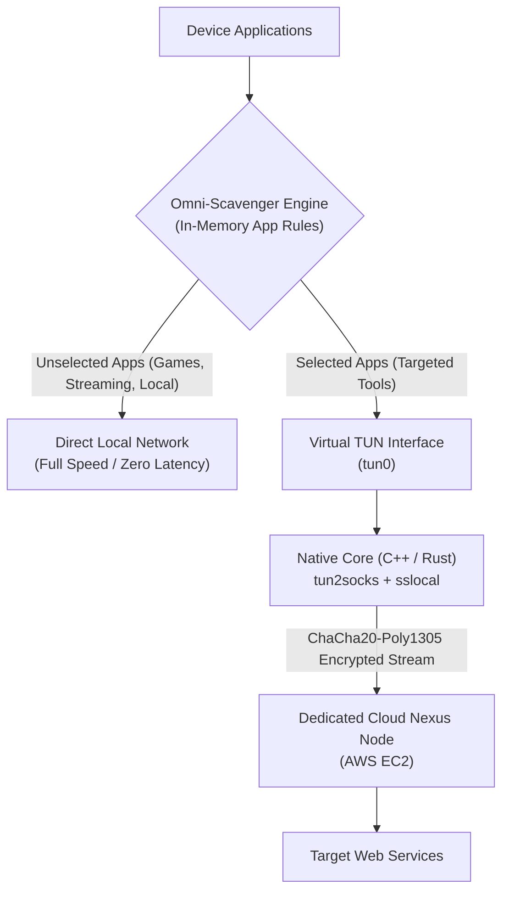
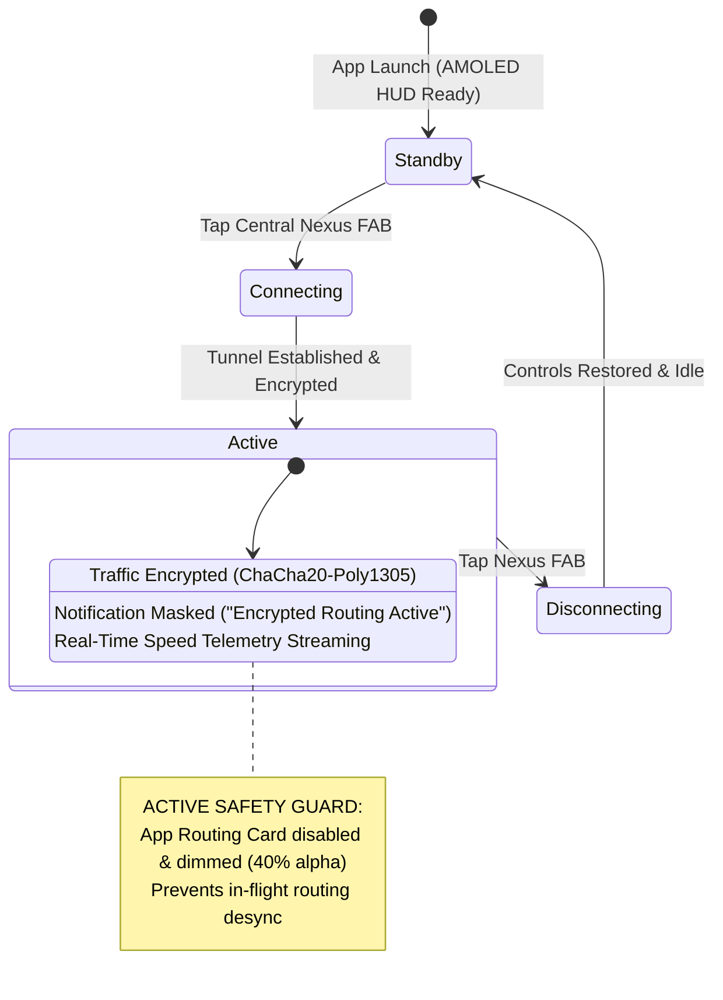

<div align="center">

  

  # 🌑 VoidCrypt
  ### **Application-Layer Network Interceptor & Stealth Tunnel**

  <p align="center">
    <b>A zero-configuration Android networking client engineered for granular per-app split-tunneling and stealth proxying.</b><br>
    Developed by <a href="https://github.com/Parth-Chavan-15"><b>Parth Chavan</b></a> as a security-focused fork of <a href="https://github.com/shadowsocks/shadowsocks-android">shadowsocks-android</a>.
  </p>

  <p align="center">
    
    
    
    
    
  </p>

</div>

---

## 👁️ Overview

**VoidCrypt** is an application-layer network interceptor designed to solve a common problem with traditional VPNs: **global routing overhead**. 

Standard VPNs force an entire device's traffic through an encrypted tunnel, creating high latency, battery drain, and bandwidth consumption for applications that don't need it. Additionally, typical clients expose server addresses in lockscreen notifications and require manual server configurations.

VoidCrypt re-architects the Android networking pipeline into an **autonomous, zero-configuration stealth tool**:
* Selectively routes targeted applications (e.g., video editing tools, browsers) through a dedicated cloud endpoint.
* Leaves all remaining apps, background services, and games on direct local Wi-Fi/cellular networks for zero latency.
* Protects privacy by permanently binding to a secure cloud nexus with zero setup required.

---

## 🛠️ What Changed in This Fork

VoidCrypt is built on top of the open-source **shadowsocks-android** (v5.3.5) codebase, heavily customized by **Parth Chavan** to create a focused, locked-down stealth client:

* **🚀 Zero-Configuration Cloud Nexus:** Stripped out manual server configuration forms, QR code scanners, and profile import/export menus. The client is permanently hardcoded to a dedicated cloud endpoint with ChaCha20-Poly1305 AEAD encryption. Just tap the central button to connect.
* **⚡ Omni-Scavenger In-Memory Split-Tunneling:** Re-engineered the underlying routing service. Instead of relying on slow database queries that can cause split-tunnel desynchronization during startup, VoidCrypt pulls routing rules directly from in-memory application preferences with multi-delimiter parsing and automatic loopback prevention.
* **🛡️ Anti-Surveillance Notification Shielding:** Standard clients display the connected server's hostname or IP directly on Android's lockscreen and status bar. VoidCrypt scrubs all endpoint metadata from system notifications, masking the service under the uniform label `"Encrypted Routing Active"`.
* **🔒 Dynamic Route Safety Lock:** Modifying split-tunnel rules while a tunnel is active can cause packet drops and socket leaks. VoidCrypt actively monitors tunnel state and automatically disables and dims the App Routing controls (to 40% opacity) while connected.
* **🎨 AMOLED Obsidian Interface:** Replaced the legacy multi-tab list layout with a custom cyber-minimalist AMOLED interface (`#000000` deep black, `#1a0b2e` obsidian, `#e25a92` neon accent), featuring an elevated one-tap Nexus button and real-time upload/download telemetry (`StatsBar`).
* **💻 Cross-Platform Build Support:** Updated the native Cargo/NDK build toolchain to automatically detect both `python` and `python3`, ensuring clean compilation across Windows, macOS, and Linux.

---

## 🧩 Architecture & Flowcharts

<details open>
<summary><b>🔍 Expand Flowchart: Traffic & Split-Tunneling Pipeline</b></summary>



</details>

<details>
<summary><b>🔍 Expand Flowchart: Tunnel Lifecycle & UI Safety Lock</b></summary>



</details>

---

## ⚙️ Quick Build Guide

Because VoidCrypt compiles native C++ and Rust networking binaries, submodules must be cloned recursively.

### 1. Prerequisites
* **Android Studio** (with NDK installed via SDK Manager)
* **JDK 17+**
* **Rust** ([rustup.rs](https://rustup.rs/))
* **Python 3**

### 2. Configure Rust Targets
Install the required Android cross-compilation targets:
```bash
rustup target add armv7-linux-androideabi aarch64-linux-android i686-linux-android x86_64-linux-android
```

### 3. Clone Repository
```bash
# Clone with all native submodules
git clone --recurse-submodules https://github.com/Parth-Chavan-15/VoidCrypt.git
cd VoidCrypt
```

*(If cloned without `--recurse-submodules`, run `git submodule update --init --recursive` inside the folder).*

### 4. Build APK
```bash
# Linux / macOS
./gradlew assembleDebug

# Windows PowerShell
.\gradlew.bat assembleDebug
```

The debug APK will be generated at `mobile/build/outputs/apk/debug/mobile-debug.apk`.

---

## 📌 Project Status

> [!TIP]
> **Active Development / Prototype:** VoidCrypt is currently a functional prototype and active work-in-progress. New stealth enhancements, UI refinements, and protocol optimizations are continuously being implemented.

---

## 🙏 Acknowledgments & Credits

VoidCrypt is built upon the open-source work of the privacy and networking community:

* **[shadowsocks/shadowsocks-android](https://github.com/shadowsocks/shadowsocks-android):** Base Android client and UI architecture created by **Max Lv**, **Mygod Studio**, and contributors.
* **[shadowsocks/shadowsocks-rust](https://github.com/shadowsocks/shadowsocks-rust):** High-performance Rust local proxy daemon (`sslocal`).
* **[badvpn / tun2socks](https://github.com/shadowsocks/badvpn):** L3-to-SOCKS5 packet translation bridge.
* **libancillary & libevent:** UNIX domain socket FD passing and event scheduling.

---

## ⚖️ License

This project is licensed under the **GNU General Public License v3.0 (GPL-3.0)**, preserving the original upstream license. See [`LICENSE`](LICENSE) for details.

Developed and maintained by **Parth Chavan** ([@Parth-Chavan-15](https://github.com/Parth-Chavan-15)).
